# Technical Report: Production-Ready MLOps AI Agent

Assignment 03, MLOps & Production AI Engineering, Fall 2026.
Repository: https://github.com/UsmanHaroon1177/assignment-03-mlops-agent

## 1. System architecture

See `architecture.md` for the full description. Summary: a FastAPI interface passes a natural-language request to an
orchestrator. Gemini chooses tools by returning JSON; the code validates each call, runs it through a wrapper
(timing, error classification, redaction, structured logging) and gives results back to the model as data.
The final answer is checked in code: a fact is kept only if every tool it cites returned `ok`.

Components: DVC (dataset versions as git tags `data-v1`, `data-v2`), MLflow (experiment `breast-cancer-classifier`),
Airflow 3 in Docker (DAG `training_pipeline`), Kubernetes on Docker Desktop (namespace `mlops-agent`,
Deployment `breast-cancer-api`, 2 replicas), a FastAPI inference service, GitHub Actions CI.

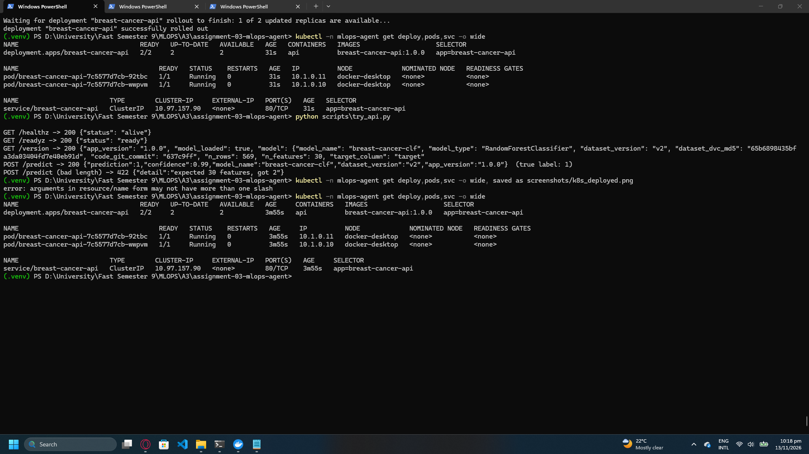
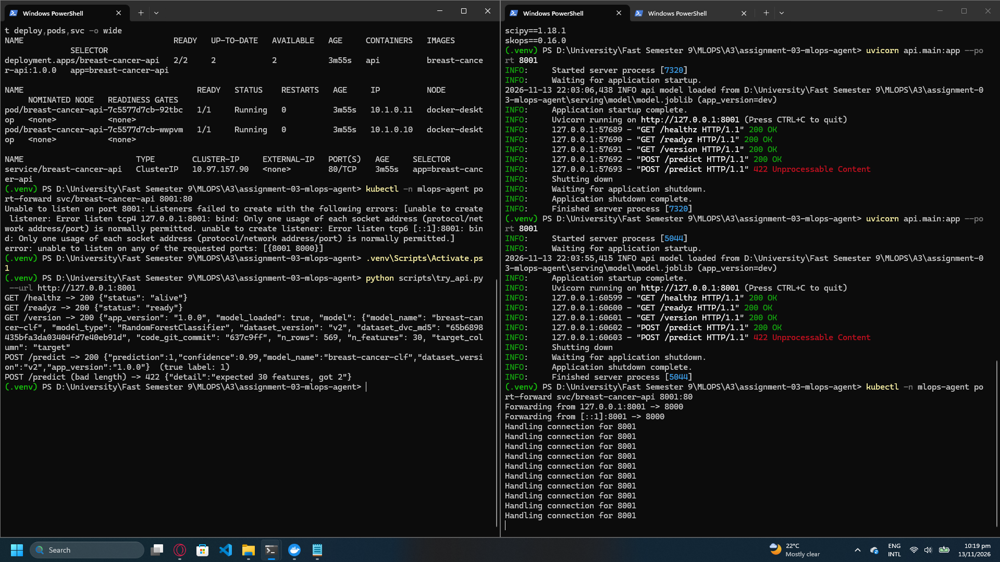

## 2. Tool definitions and permissions

28 tools. Names, scopes and permissions are listed in `architecture.md` (section "Tool inventory and permissions").

| Module | Read-only tools | Mutating tools |
|---|---|---|
| DVC | 6 | none |
| MLflow | 7 | none |
| Airflow | 5 | `airflow_trigger_training` (confirmation required) |
| Kubernetes | 8 | `k8s_rollout_restart` (confirmation + namespace `mlops-agent` only) |

Safety controls enforced in code:
- No `shell=True`; git allowlist {log, show, tag, rev-parse, ls-files, status}; dvc allowlist {status, diff}.
- Only DAG `training_pipeline`; only namespace `mlops-agent` and label `app=breast-cancer-api`.
- Mutating tools never run from model output. They become pending actions; `confirm(id)` is user-initiated, one-shot, expires after 10 minutes and sets `confirmed=True` itself. A model-supplied `confirmed` argument is stripped.
- Tool output is redacted (keys, tokens, passwords) before the model or logs see it; logs hold argument names only.
- Retraining advice without evidence (failed quality gate, or user-supplied freshness/degradation figures) is removed by `agent/policy.py`.

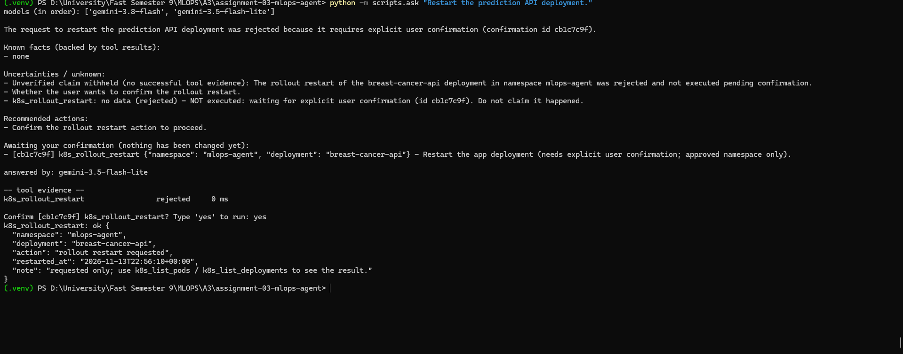
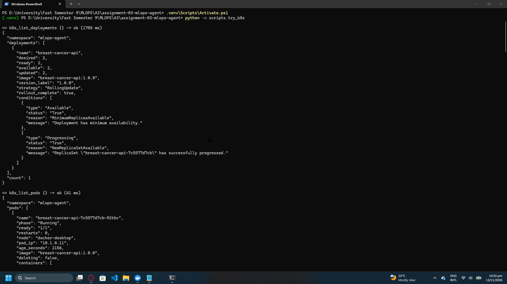

## 3. Evidence from DVC, MLflow, Airflow and Kubernetes

- **DVC:** reproduction of the training stage and dataset checkout.
  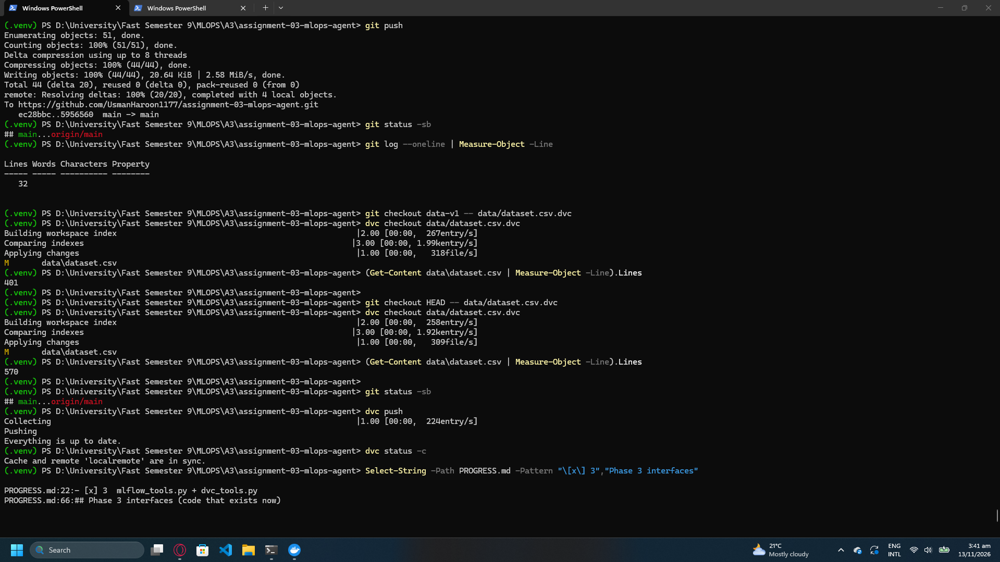
- **MLflow:** six seeded runs (v1/v2 x logreg/rf/gbm), two registered models. 
  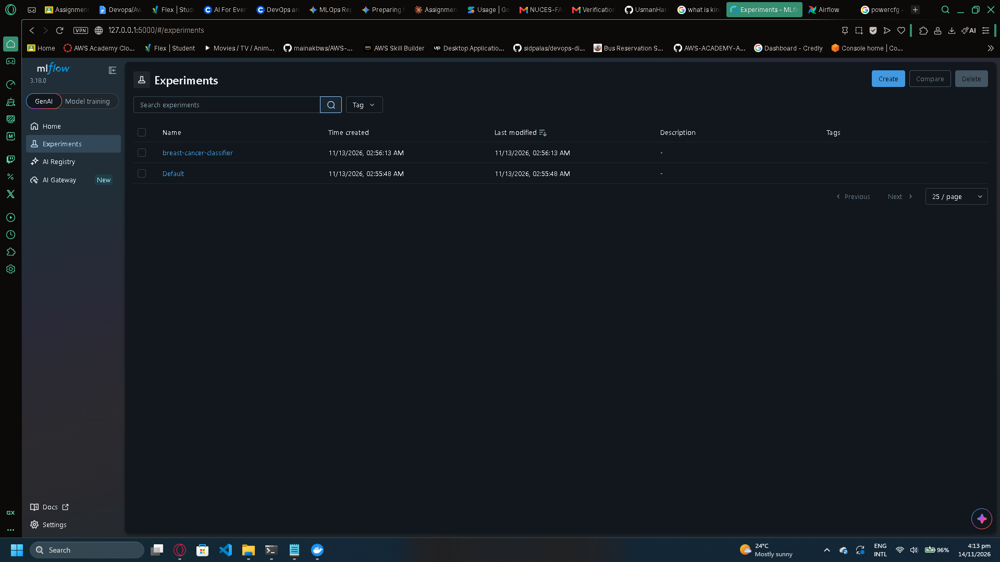
- **Airflow:** successful run, a quality-gate failure, and a successful run after the MLflow host fix.
  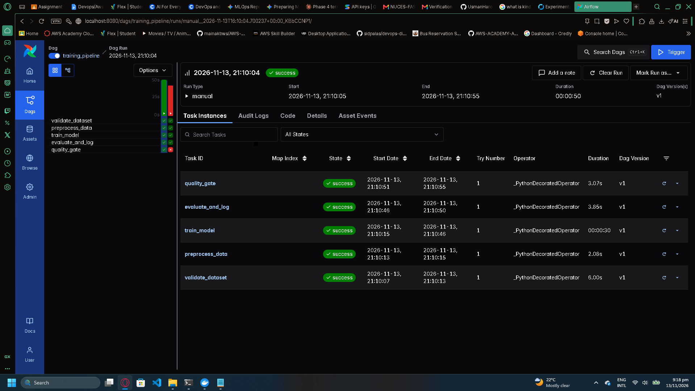
  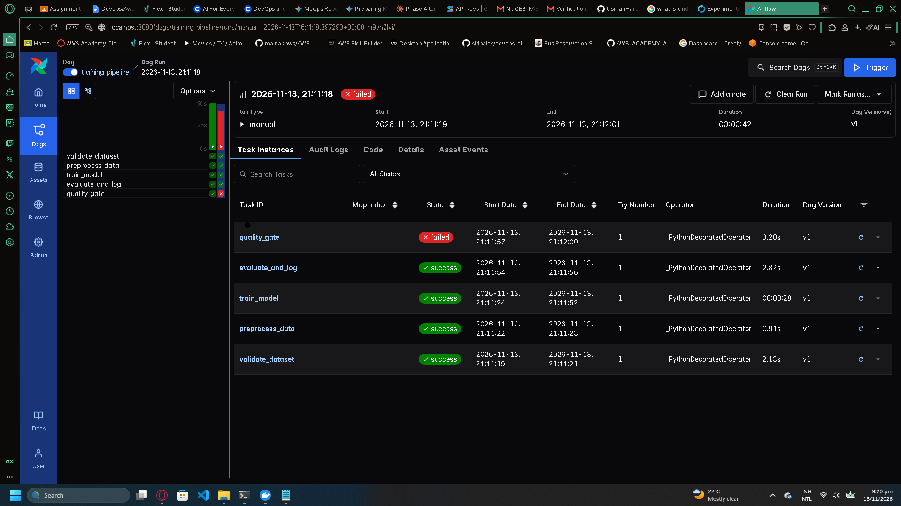
  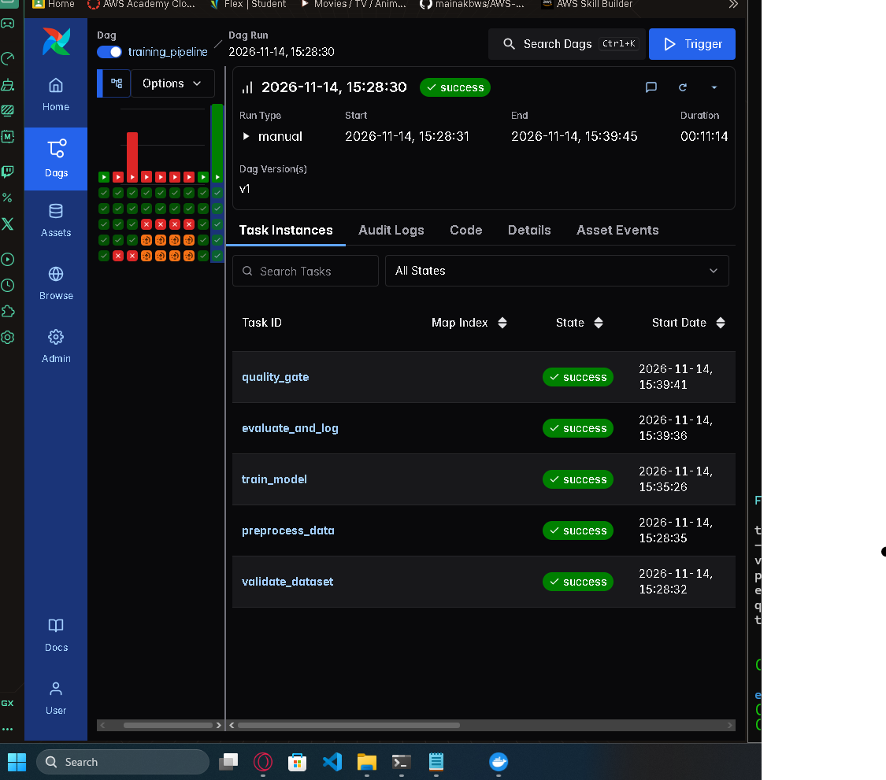
- **Kubernetes:** see section 1 and the failure investigations below.

## 4. Five tested agent conversations

Full answers with tool evidence tables are in `evidence/`. The model that answered each is recorded in the file header
(`-latest` aliases can change behaviour, so record the demo date).

| # | Scenario | Question | Evidence tools | Result | File |
|---|---|---|---|---|---|
| 1 | Dataset provenance | Which dataset version trained the best run by F1, and how do I reproduce it? | `mlflow_find_best_run`, `dvc_get_run_dataset_version`, `dvc_explain_reproduce_version` | Run `7c4b42ef...` trained on v1 (md5 `c21108...`, commit `484f7cf`), reproduce with `git checkout data-v1 -- data/dataset.csv.dvc` and `dvc checkout` | `evidence/demo1_dataset_provenance.txt` |
| 2 | Model selection | Compare the last five runs; is the highest F1 production-ready? | `mlflow_find_best_run`, `mlflow_list_runs` | Four runs tie at F1 0.966 on v2; stated that one hold-out split and a tiny margin do not make a model production-ready | `evidence/demo2_model_selection.txt` |
| 3 | Pipeline execution | Status of the latest Airflow run and tasks | `airflow_get_run_status`, `airflow_get_failed_tasks` | All five tasks `success`; `train_model` succeeded on try 3 | `evidence/demo3_pipeline_execution.txt` |
| 4 | Deployment diagnosis | Is the API healthy on Kubernetes? | `k8s_find_unhealthy_pods`, `k8s_list_deployments`, `k8s_list_services`, `k8s_get_deployed_version`, `k8s_get_events` | 2/2 ready, version 1.0.0, 2 ready service endpoints; old probe warnings reported as past events | `evidence/demo4_deployment_diagnosis.txt` |
| 5 | Multi-tool reasoning | Best model, dataset version, deployment status, is retraining necessary? | `mlflow_*`, `k8s_*`, `airflow_*` (and `dvc_*` where the model called it) | Retraining judged not justified (no failed gate, no freshness policy); image-to-run link reported as unverified | `evidence/demo5_multi_tool.txt` |

Scenario 5 was also captured during a real Airflow outage (`evidence/demo5_multi_tool_airflow_outage.txt`):
`airflow_list_dag_runs` returned `unavailable`, the agent listed Airflow status as unknown, made no claim about the
pipeline and withheld its own retraining suggestion. This demonstrates the "no invented results" requirement on a real service.

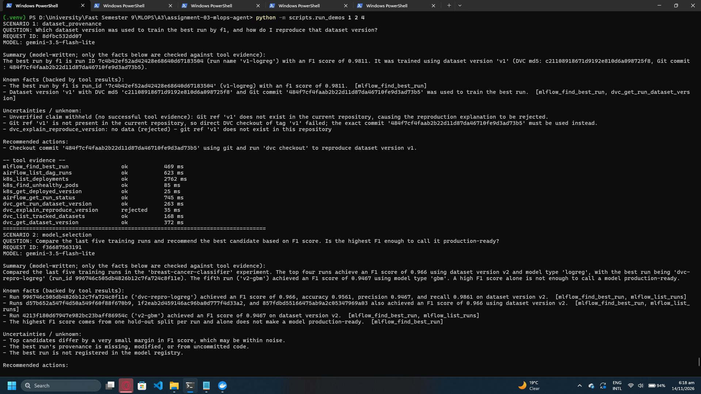
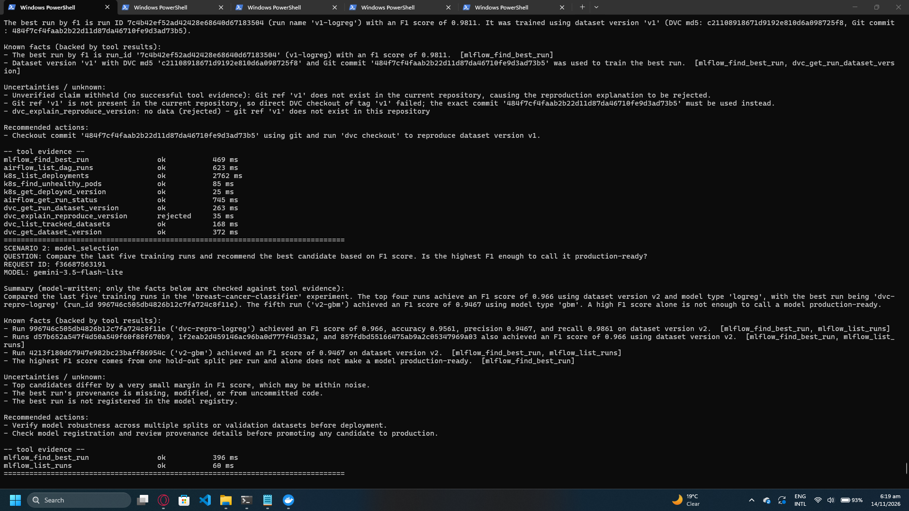
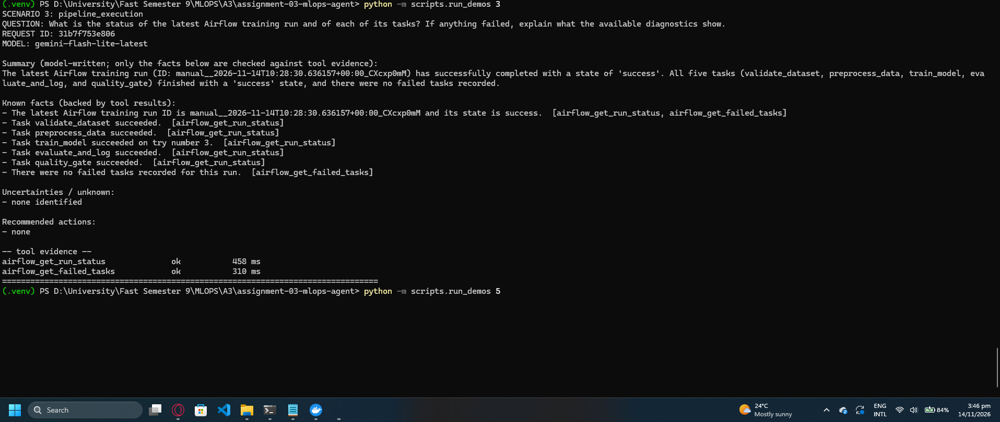
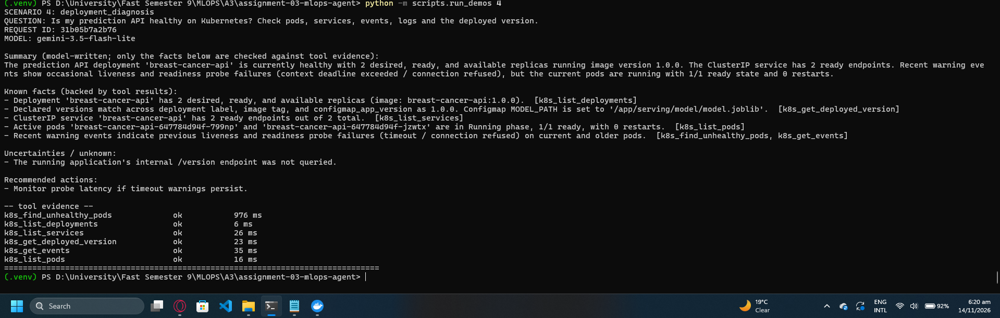
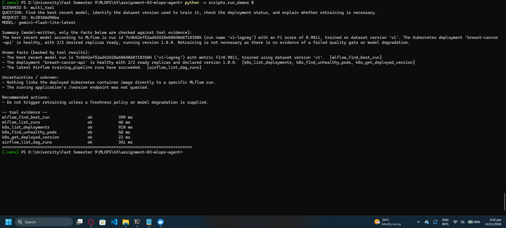
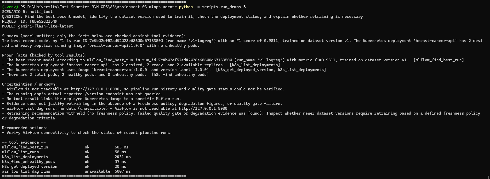

## 5. Failure investigations

### Failure 1 (injected): wrong MODEL_PATH
- **Injection:** `scripts/inject_failure.ps1 -Mode badpath` set `MODEL_PATH=/app/serving/model/missing.joblib` in the ConfigMap and restarted the Deployment.
- **Symptom:** new pods `Running 0/1`, deployment 1/2 ready, readiness probes returning 503 while liveness stayed 200.
- **Agent diagnosis** (`evidence/failure1_badpath.txt`): tools `k8s_find_unhealthy_pods`, `k8s_get_pod_status`, `k8s_get_pod_logs`, `k8s_get_events`. It cited the log line `FileNotFoundError ... /app/serving/model/missing.joblib` and recommended correcting the ConfigMap/model path. It did not claim to fix anything.
- **First attempt was weaker:** the first diagnosis stopped at "inspect application dependencies". Cause: the log tail was dominated by probe noise and no tool exposed `MODEL_PATH`. Fix: `k8s_get_pod_logs` now returns `error_lines` with a deeper default tail, and `k8s_get_deployed_version` exposes non-sensitive ConfigMap values.
- **Resolution:** `.\scripts\inject_failure.ps1 -Mode restore`, rollout back to 2/2.
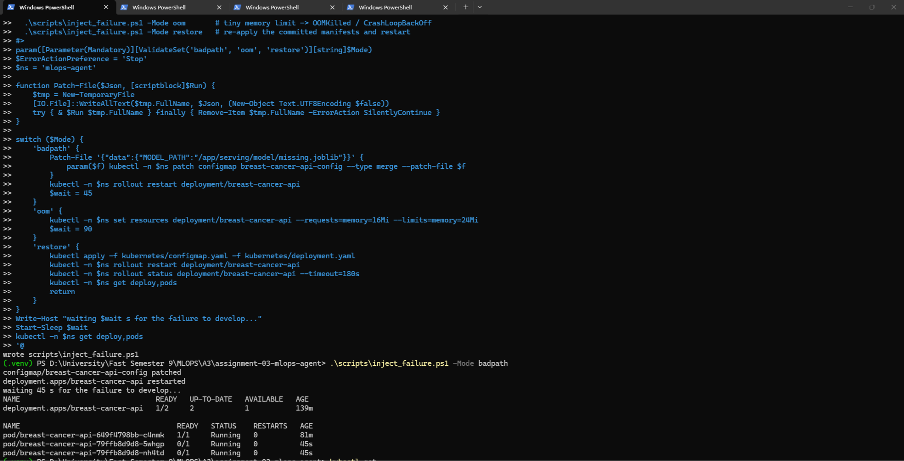
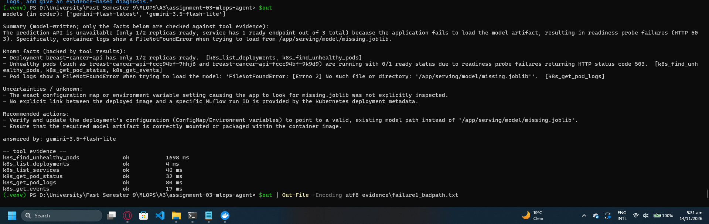

### Failure 2 (injected): OOMKilled
- **Injection:** `-Mode oom` set the memory limit to 24Mi (request 16Mi).
- **Symptom:** `CrashLoopBackOff` with rising restart counts, deployment 1/2 ready.
- **Agent diagnosis** (`evidence/failure2_oom.txt`): cited `OOMKilled` (exit 137), the 24Mi limit and 16Mi request from the pod resources, restart counts and BackOff/probe events; recommended raising the memory limit and monitoring afterwards.
- **Resolution:** `-Mode restore` re-applied the committed manifests.
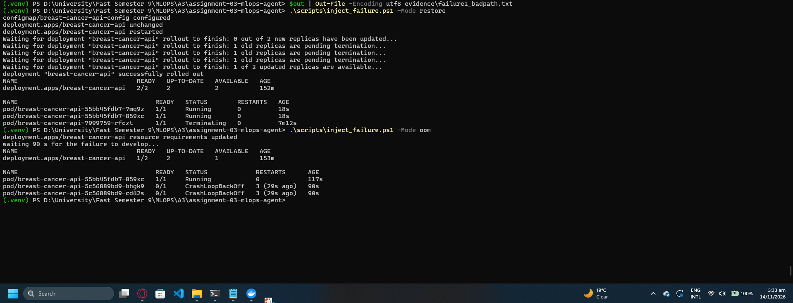
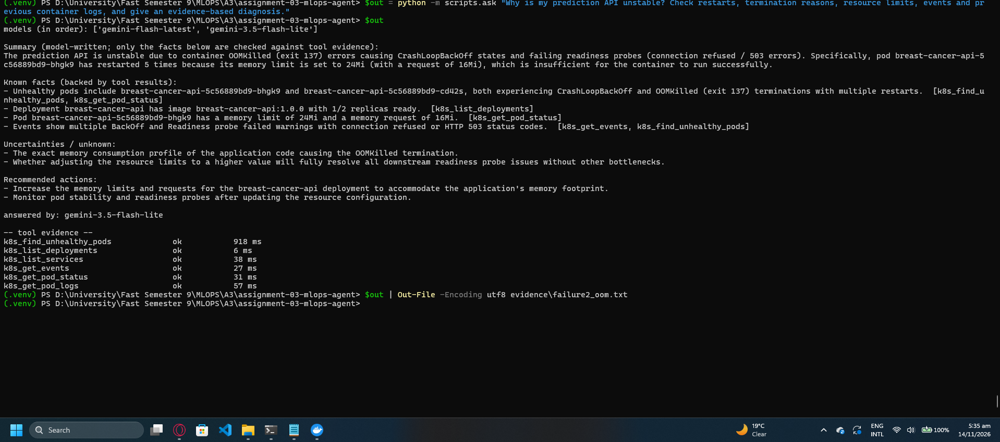

### Failure 3 (unexpected): Airflow `train_model` failing, then slow
- **Symptom:** `train_model` failed on all 3 attempts in two separate runs, with the quality gate not involved. The agent reported "failed at `train_model`" but could not give a cause, and did not invent one.
- **Root cause:** running the training command inside the container showed MLflow returning `403 Invalid Host header - possible DNS rebinding attack detected` for `host.docker.internal`. The MLflow server had been started without `--allowed-hosts`.
- **Resolution:** restart MLflow with `scripts/start_mlflow.ps1` (binds 0.0.0.0, allows `host.docker.internal`). The next run succeeded.
- **Follow-up:** the run then took 11 minutes. The container sat at about 1.9 of 2.5 GB with high block I/O and low CPU: git/dvc provenance calls and artifact writes on a Windows-mounted volume are slow.
- **Gap found:** the Airflow log tool only returned the head of the task log, so the stderr in the exception was past the tail. Fixed afterwards: `airflow_get_failed_tasks` now includes the exception type and message from `error_detail`, so the agent can see the MLflow 403 itself.

### Failure 4 (process): CI caught an incomplete push
`orchestrator.py` was pushed importing `evidence_gaps` while `policy.py` had not been committed. GitHub Actions failed at test collection with an ImportError. Fix: commit the missed files; lesson: run `git status -sb` before every push.

## 6. Testing and CI

Offline pytest suite (mocked MLflow, Airflow, Kubernetes and Gemini; scripted `FakeLLM`), 126 tests, coverage of `agent/` 88%.
Requirements covered: tool selection and execution, unavailable services, timeouts, invalid requests, no invented results when a tool is unavailable, unauthorized Kubernetes changes rejected, structured logs with request IDs and no secrets, FINISHED-only MLflow runs.
GitHub Actions runs `ruff check` and `pytest --cov` on pull requests and pushes to main; no secrets are used.

## 7. Known limitations and proposed improvements

Limitations:
- The model-written summary is not evidence-checked; only known facts are.
- Kubernetes tools report declared versions (label, image tag, ConfigMap); nothing proves which MLflow run produced the deployed image.
- The retraining guard filters recommendations, not free text in the summary.
- Free-tier Gemini is slow (about 2 minutes per answer) and rate limited; `-latest` aliases can change behaviour.
- A model sometimes calls a tool with a wrong argument (for example git ref `v1` instead of `data-v1`); the tool rejects it and the answer reports the gap.
- Airflow in Docker on 8 GB RAM is I/O bound.
- Probe warnings from past events can appear in a healthy deployment's answer.

Proposed improvements:
- Query the running app's `/version` endpoint and record the MLflow run id as an image label to close the provenance gap.
- Filter events by recency so old startup warnings are ignored.
- Evidence-check or regenerate the summary from the verified facts.
- Use a named Gemini model and a paid tier for stable latency; move Airflow to a Linux volume or WSL path.